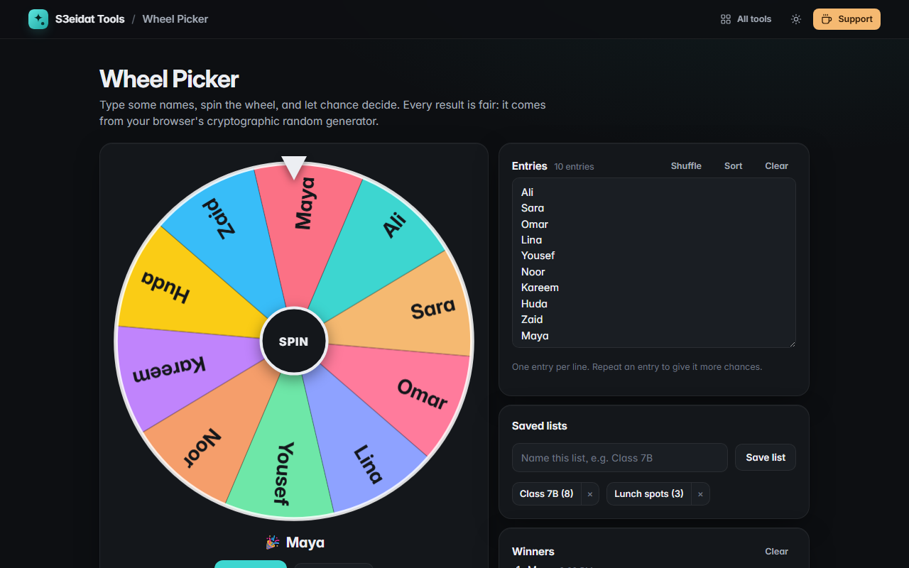

# Wheel Picker

> Spin a wheel to pick a random name or option. Free, private, and it runs entirely in your browser.

### ▶ [Open Wheel Picker](https://s3eidat.github.io/wheel-picker/)



## Features

- Type entries **one per line** (repeat one to give it more chances); up to 500
- Colourful **canvas wheel** with a realistic ease-out spin and a **tick sound** as it passes each slice
- **Fair results**: the winner is drawn with crypto.getRandomValues and rejection sampling (no modulo bias) before the wheel starts moving
- **Winner pop-up with confetti**; remove the winner from the wheel, or turn on automatic remove-after-spin
- **Saved lists** (e.g. a class or team) and a history of recent winners
- Shuffle, sort, **fullscreen** for projectors; click the wheel or press <kbd>Enter</kbd>/<kbd>Space</kbd> to spin

## Privacy

Your entries, lists and history are saved only in your browser (localStorage). There is no server, no account, no analytics.
The page ships with a strict Content-Security-Policy (`connect-src 'self'`), so the browser
itself blocks any attempt to send data anywhere.

## Run it yourself

It's plain HTML, CSS and JavaScript with no build step:

```bash
git clone https://github.com/s3eidat/wheel-picker
cd wheel-picker
python -m http.server 8000
```

Then open http://localhost:8000.

## Support

If this saved you time, **[buy me a coffee ☕](https://s3eidat.github.io/coffee/)**. It keeps every tool free.

---

Part of **[S3eidat Tools](https://s3eidat.github.io/)**: 100+ free, private tools that run in your browser. MIT licensed.
